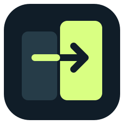
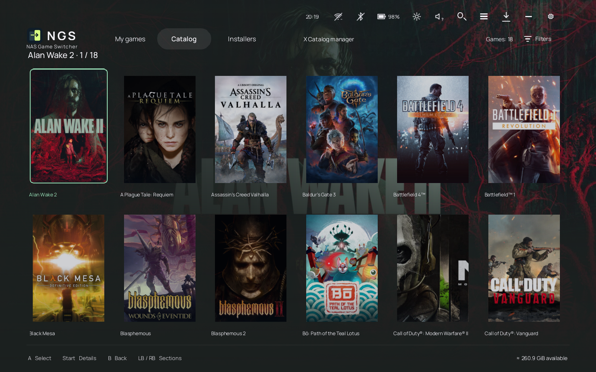
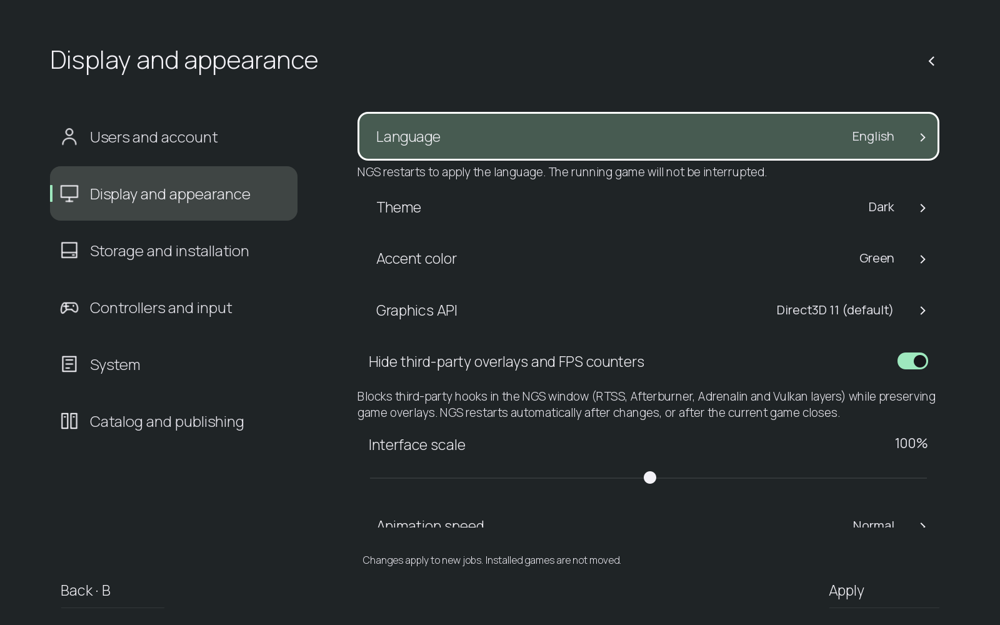
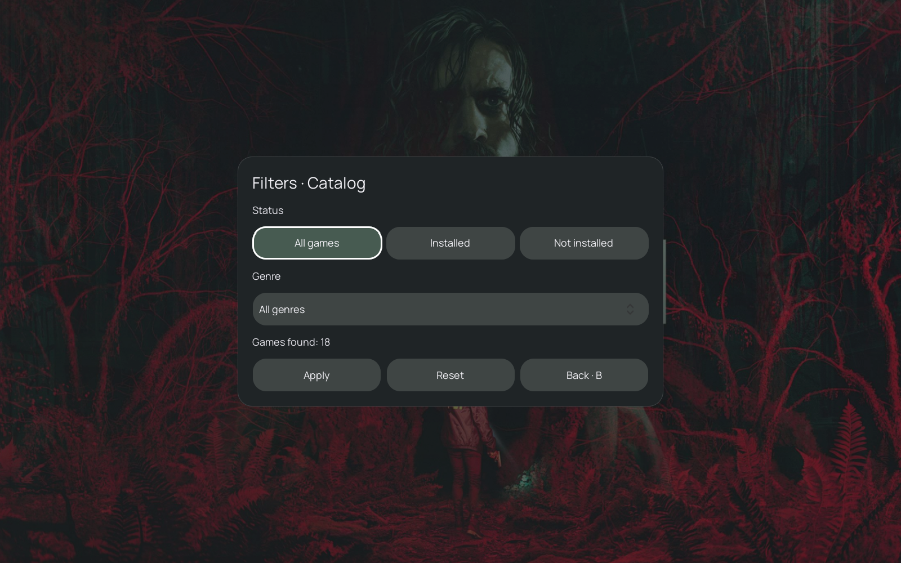
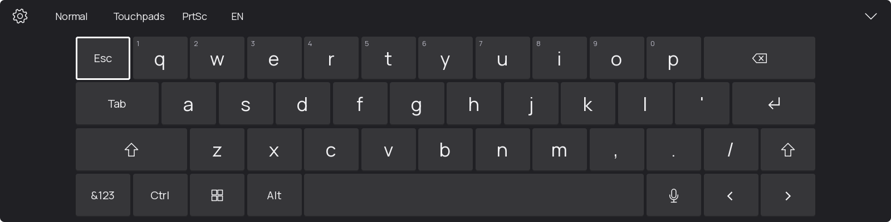
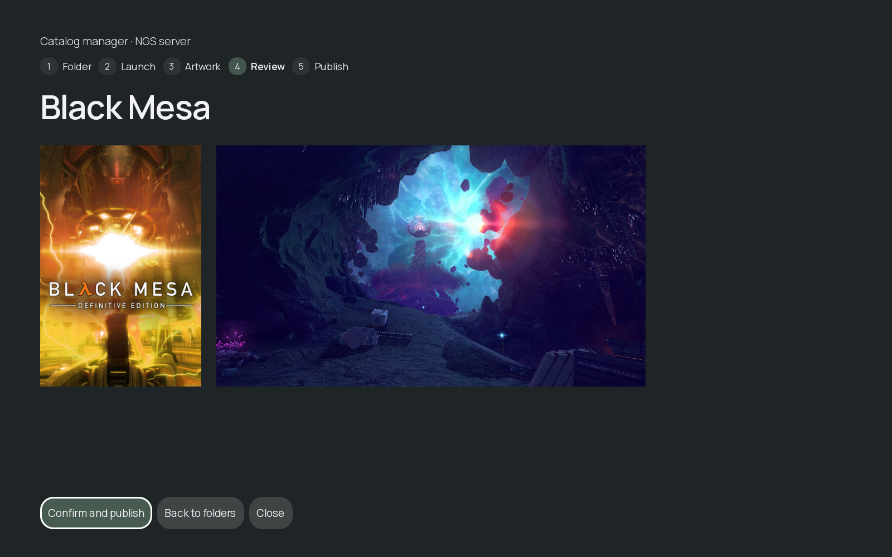

**English** · [Русский](README.ru.md)

  
  <h1>NAS Game Switcher</h1>
  
<b>Your NAS library. Your Windows handheld. One place to play.</b>

  
Browse, download and launch your own PC games with a controller or touchscreen.

  
<a href="https://github.com/listyque/NAS-Game-Switcher/releases">Download for Windows</a> · <a href="server/README.md">Docker & Synology setup</a> · <a href="docs/guide.md">User guide</a> · <a href="https://github.com/listyque/NAS-Game-Switcher/issues">Report a bug</a>

  
<b>Preview · Work in progress</b>

NGS turns a self-hosted game collection into a library designed for Windows handhelds. Keep games on the NAS, download what you want to play locally, and move between your game and NGS controls. The server is yours; NGS does not include games or provide a hosted account service.

**No NAS? Start locally.** A fresh installation opens My games without registration or a server. Add your game folders or scan installed store games; covers, backgrounds and descriptions are fetched directly from game providers and cached on your device. The library, launch settings and play history live in SQLite. Connect a NAS later if you want downloads, profile sync and server backups.

## What you can do

- **Browse comfortably:** controller, touch and mouse navigation; grid and detail views; real metadata, artwork, filters, sorting and favorites.
- **Keep storage predictable:** queued downloads reserve space, resumable transfers verify their contents, and local folders can use readable game names.
- **Play locally:** launch downloaded games and supported local/store entries; return to the session screen to see playtime or stop the game.
- **Type without a physical keyboard:** the built-in keyboard has eight views, custom layouts, themes, macros, controller-to-key assignments and touchpads.
- **Manage your NAS collection:** separate catalog managers guide you through publishing ready-to-play games and complete installation packages, with artwork matching and batch actions.
- **Use handheld controls:** a compact swipe handle opens volume, brightness and other quick settings. Optional NGS Input lets the keyboard and controls appear above supported Windows system windows. Configure or disable the top menu in Settings.
- **Keep your own profile:** register on your NAS, sign in on another device, sync play history and back up settings. Reset a game's local statistics on the current device.
- **Make it yours:** English by default, Russian available in Settings, accent colors, themes, scaling and Production Mode to reduce diagnostic logging.
- **Host it yourself:** Docker or a Synology SPK, read-only game sources, separate player/owner access and optional Internet HTTPS without VPN.

Filters in NGS

## A keyboard built for handhelds

Choose a normal, compact, split, traditional, gamepad, full, navigation or NumPad view. Adjust height and opacity, select a theme, create your own layouts and macros, or use the two touchpads for cursor control. Auto-show responds to a finger tap on an editable field. Controller presets and individual key assignments cover games that expect a keyboard.

The keyboard is included in NGS. The optional **NGS Input** Windows component extends where the controls can appear, including above Start and supported system windows. [Keyboard, touchpads and controller guide](docs/guide.md#built-in-keyboard).

## Turn NAS folders into a game library

Two built-in catalog managers cover different collections: **ready-to-play games** for local download and launch, and **installer packages** for normal setup on the device. Select a folder and executable, match the game artwork, review and publish. Batch actions process clear matches and leave uncertain ones for review. Publishing requires server-owner access; NAS source folders remain read-only.

The [illustrated user guide](docs/guide.md) covers both catalog managers, every main-menu item, all six settings sections, keyboard options and quick controls. [Русская версия руководства](docs/guide.ru.md). Screenshots use real cached game artwork; sample catalog rows and system values illustrate the UI.

## Get started

### Windows handheld or PC

1. Download **NGS-Setup-*.exe** from [Releases](https://github.com/listyque/NAS-Game-Switcher/releases).
2. Install and launch NGS. Choose the optional **NGS Input** component if you want controls over games; Windows asks for permission to install it.
3. **Local library:** open **My games** and add a game folder or scan installed store games. No account or server is required.
4. **Optional NAS:** open **Settings → Users and account → Connect a NAS server**, enter its address, then register or sign in.
5. For NAS access over local HTTP, enter the pairing code from the NAS app log once. With trusted HTTPS this step is automatic. After sign-in, Catalog and Installers become available.

**Requirements:** Windows 11 x64. Python is bundled. A portable ZIP is also available; extract the entire folder and run `NGS.exe`. Keep its `data` folder when moving or updating it.

### Docker on your NAS

1. Download and extract **NGS-Docker-0.1.0-preview.2.zip** from Releases.
2. Copy `.env.example` to `.env` and enter your game folder path.
3. Run `sh start.sh` and choose an admin password.
4. Open `http://NAS-IP:8890/assets/ngs_launcher/client/` and follow the connection instructions.

### Synology

1. Install Container Manager on an x86-64 NAS running DSM 7.2.1 or later.
2. In **Package Center → Manual Install**, select **NGS-Synology-0.1.0-preview.2.spk** from Releases.
3. Enter the game folder, port and admin password. Leave the domain blank if you only need LAN access.
4. Open **NAS Game Switcher** from DSM, then connect the Windows client.

Both packages start with an empty, independent database and create their own keys on your NAS. They include no personal data or games. Full instructions, backups and optional public HTTPS: **[Server setup](server/README.md)**. Set up a domain later; Internet access requires trusted HTTPS for both NGS and administration.

## How it compares

These projects serve related needs with different approaches. “Documented” means the linked project describes the feature; this is not a performance benchmark.

| | NGS | [GameVault](https://gamevau.lt/docs/intro/) | [LANCommander](https://lancommander.app/) | [Gameyfin](https://gameyfin.org/) |
|---|---|---|---|---|
| Main experience | Windows handheld launcher | Windows game client | Self-hosted game distribution and launcher | Browser-based game library |
| Self-hosted NAS / Docker server | Yes | [Yes](https://gamevau.lt/docs/server-docs/setup/synology-container-manager/) | [Yes](https://lancommander.app/GettingStarted/) | [Yes](https://gameyfin.org/installation/docker/) |
| Download games to a local PC | Yes | Documented | Documented | Browser downloads |
| Controller navigation | Yes | [Documented since v17](https://gamevau.lt/docs/client-docs/gui/) | Check current client documentation | Browser/device dependent |
| Handheld quick controls over games | Optional NGS Input | Check current integrations | Check current integrations | Outside the browser library's scope |
| Synology delivery | Dedicated SPK preview + Docker | Official Container Manager guide | Docker deployment | Docker deployment |
| Project status | Early preview; device validation ongoing | See project | See project | See project |

Choose the workflow that fits your collection. NGS focuses on a handheld UI, local play and controls around the game; the alternatives have their own strengths and larger established ecosystems.

## Current limits

This is active work, not a finished commercial launcher. Different games, launchers, anti-cheat systems and exclusive fullscreen modes handle focus and overlays differently. An always-visible overlay over every game is not guaranteed. Touch behavior, installed UIAccess and DSM packaging need real-device validation; automated checks cannot replace it. No game-specific launch fixes are promised by these screenshots.

The optional input component currently uses the project's local publisher certificate; Windows installation asks to trust that publisher. Only install release files you obtained from this repository. Do not expose raw TACTIC or PostgreSQL ports to the Internet. The server guide describes the HTTPS gateway and owner access checks.

## Build from source

Windows builds use **Python 3.13 x64, MSVC, Nuitka 4.1.1 and PySide6 6.11.2**. Install `requirements-build.txt`. Run `python -m tools.compile_translations`, build/sign NGS Input with `python -m tools.build_input_host` and the included signing scripts, then run `python -m tools.build_windows`. Build the installer with `python -m tools.build_installer <portable-folder> --compiler <makensis.exe>`. Signing needs your own certificate; set its publisher thumbprint in `ngs/input_host.py` and `tools/launch_input_install.ps1` before building. Private keys are not in this repository.

For the server, build `server/Dockerfile`. `python -m server.package_bundle` creates the online Docker kit. To build the offline SPK, export the three Compose images to `server/images/ngs-images.tar`, then run `python -m server.build_dsm`. Tests live in `tests`; Qt tests use an offscreen platform, and DSM lifecycle tests run on Linux as an ordinary user. Compile translations before rebuilding either Windows component.

## License and credits

NGS's own code is [MIT licensed](LICENSE). Qt/PySide, TACTIC, Python, Manrope and other dependencies retain their own licenses; see [third-party notices](THIRD_PARTY_NOTICES.txt) and the notices bundled with releases. Games and artwork shown in screenshots belong to their respective owners and are not included with NGS.
