**English** · [Русский](guide.ru.md) · [Project overview](../README.md) · [Server installation](../server/README.md)

# Using NAS Game Switcher

Your games, downloads and handheld controls in one place. This guide covers the built-in keyboard, both NAS catalog managers, the main menus and every settings section in the current preview.

NGS is a work in progress. Available hardware controls and overlay behavior depend on Windows, the device and the running game.

## Library and main menu

### Local library without a server

A fresh installation opens **My games** immediately. You do not need a NAS, Docker, an account or an Internet connection to add and launch existing local games. Use **Add a game from this device** to choose a folder or scan supported Steam, GOG, Epic Games Store and Battle.net installations.

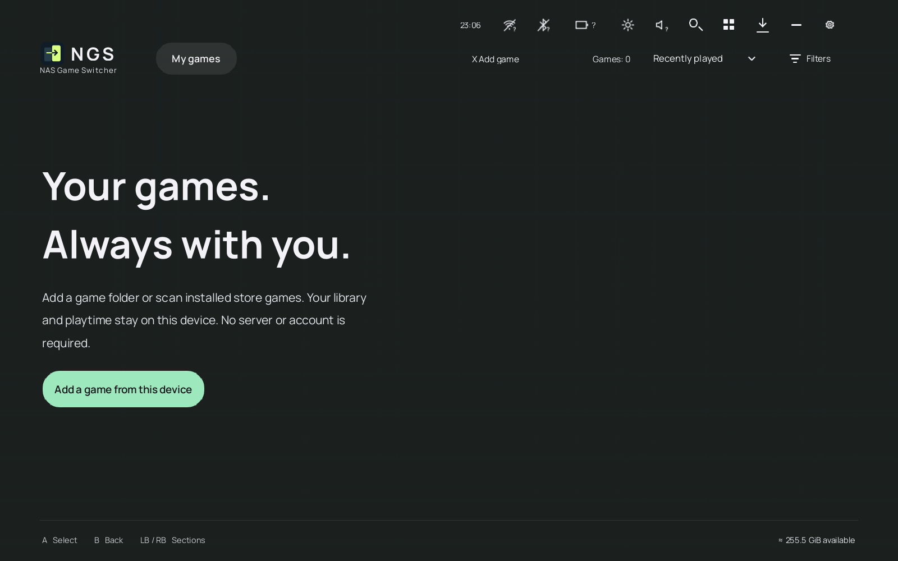

The library, launch options and play history are stored locally in **`data/state/library.sqlite`**. Keep the whole **data** folder to retain settings, cached artwork and other profile files too. Games stay in the folders where you installed them. Local mode does not start NAS downloads, profile synchronization or server backups.

Covers, backgrounds and descriptions come directly from public game providers: Steam, GOG, Epic Games Store and community sources. A NAS, account and personal API key are not required. The first download needs Internet access; saved descriptions and images remain available offline. Store imports and folder scans enrich clear matches automatically. NGS also fills missing artwork in the existing local library while idle; disable **Settings → Catalog and publishing → Find artwork for local games** to stop automatic lookups. Ambiguous matches stay available for manual selection through a game's artwork action. Local game files, launch options and playtime are preserved when artwork changes. Steam descriptions follow the English/Russian interface language.

If a game is missing artwork or was identified incorrectly, open its card in **My games → Change game / artwork**. Search by the correct title or paste a supported store link, choose a result, then check its cover and description. **Use this game** saves the choice; **Back to results / B** lets you choose another result without changing the library. You can also do this while adding a local game. A confirmed manual choice survives restart and is protected from automatic matching.

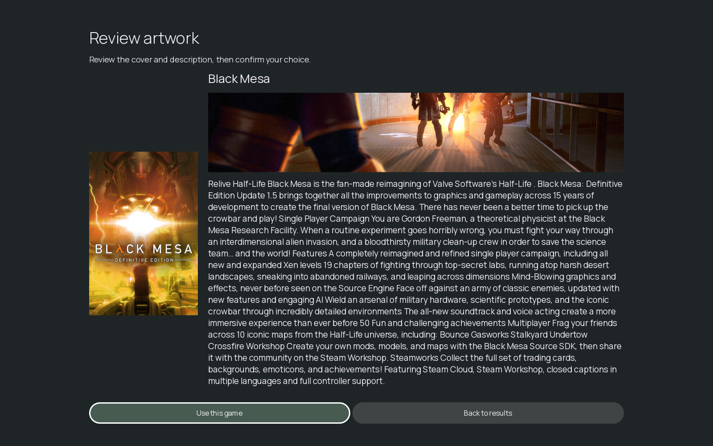

If no provider has the game, choose **Add artwork manually** on that search screen. Enter its title and description, continue to **Images**, choose a PNG, JPEG or WebP cover from disk and save. A separate background is optional; for a new card NGS uses the cover if no background is selected. Images are copied and resized into the local cache, so moving or deleting the originals does not remove them from the library. This works without Internet access, including while adding a local game. You can reopen the editor to change your title, description or pictures later; automatic lookup leaves custom cards alone.

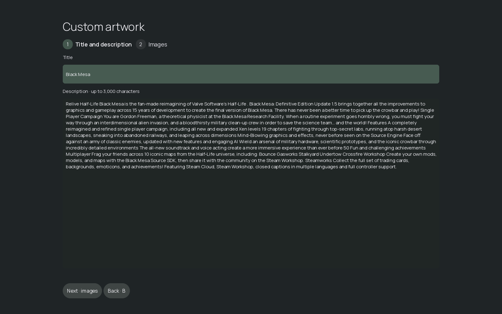

To connect later, open **Settings → Users and account → Connect a NAS server**, enter the address and sign in or register. Successful sign-in enables Catalog and Installers while preserving your local library and statistics. Previous local play history is uploaded only through the separate **Upload previous history** action. To return to local mode, choose **Use without a server** on the account page after active games and server operations finish.

| Area | What it does |
|---|---|
| **My games** | Games already available on this device, including supported store entries and folders you add yourself. Use the add/scan action to find local games. |
| **Catalog** | Ready-to-play games published on your NAS. Download a game to a local destination before playing. |
| **Installers** | Installation packages published on the NAS. Download the complete package, run its setup, then add the installed game to My games. |
| **Search** | Find games in the current library. |
| **Filters** | Filter by genre and availability. Local-library filters also help find unplayed or unavailable games. Available choices depend on the section. |
| **Sort** | Recently played, date added, title or genre; choose the order. |
| **View** | Switch between the ribbon and grid layouts. |
| **Downloads** | View the queue and transfer progress; pause, resume or cancel downloads. Queued games reserve local space. |
| **Program menu** | Settings, Minimize and Exit NGS. |

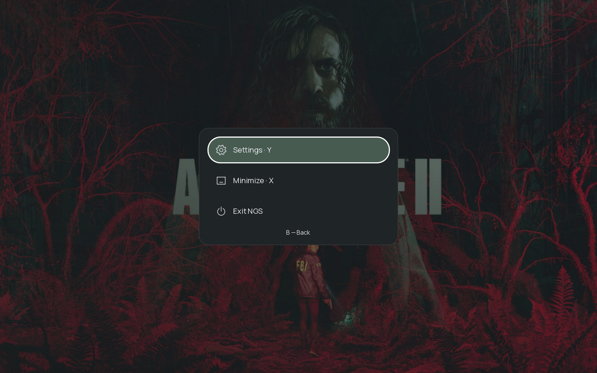

Use the highlighted control and the button hints shown on screen: **A / Enter** activates, **B / Back** returns. Hints follow the active input device and configured bindings. You can also use touch or a mouse.

With a keyboard, use **arrow keys** to move, **Enter** to activate, **F10** for game information, **Esc** to go back, **Q / E** to change sections, **F2** for settings and **Ctrl+F** to search. Keyboard hints are visible from startup and return when you use the keyboard or mouse after a gamepad.

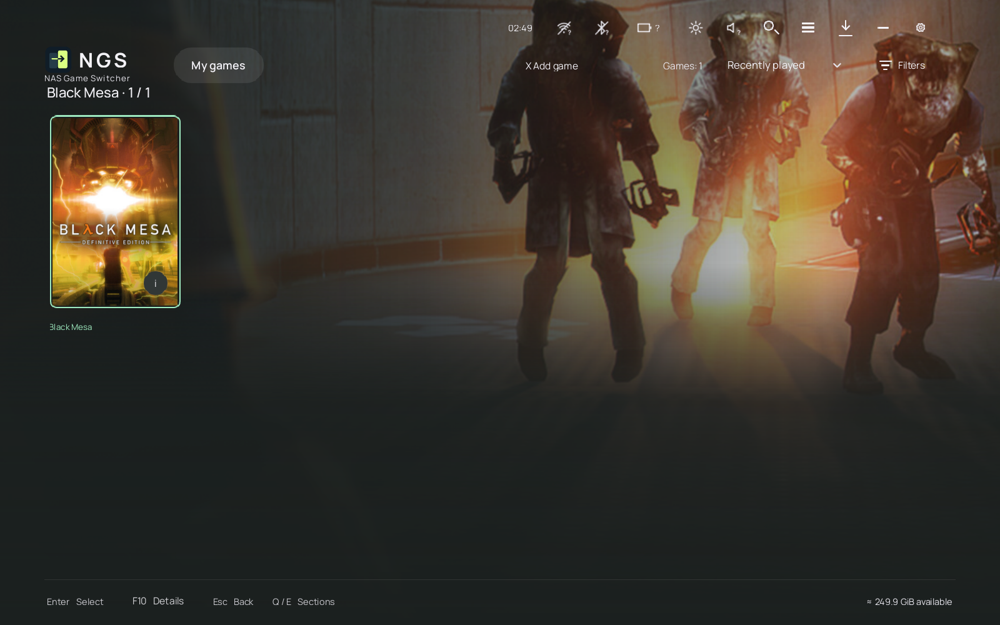

To view a game without launching it, click or tap the **i** on its tile, use the ribbon's **Details** button, click **F10 · Details** in the footer, or press **F10**. The card shows **Statistics on this device**: total playtime, launch count and longest session, including completed games. Opening it never starts the game. A game with no recorded sessions shows zero values. The running-game screen also retains its live session and shared-profile statistics.

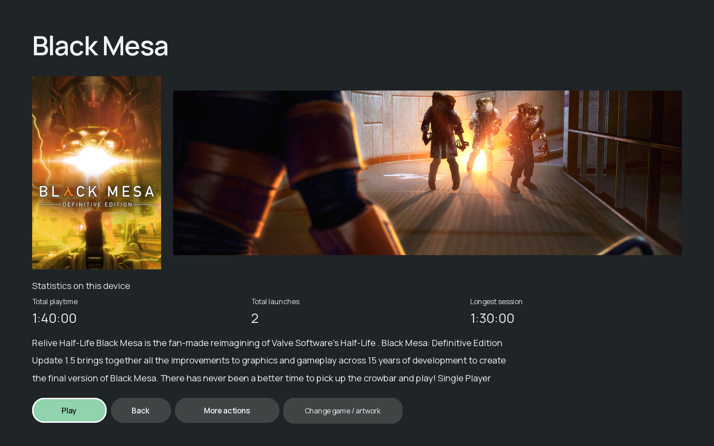

**Reset statistics** is also available directly in the card. Confirm **Reset on this device?** to clear that game's displayed totals on this device without starting it. Shared profile totals and other devices are preserved; Cancel leaves the statistics unchanged.

Change **Settings → Display and appearance → Language**, then choose **Apply**. The launcher and connected NGS Input interface change language immediately; the NGS window and running game stay open. Other settings such as the graphics API may still require restarting NGS.

A game's details provide its description, artwork and available actions: download or play, favorite, launch configuration, folder/executable selection and library management. The session screen shows play statistics, returns to the game, minimizes NGS and can stop the running game. **Reset statistics** resets that game's statistics on the current device.

Removing an external entry from the library leaves its files in place. Deleting an NGS-managed download is a separate action with confirmation.

## Built-in keyboard

The NGS keyboard is included in the client. Open it from **Settings → Controllers and input → Buttons and gamepad → Macros and gamepad → Open keyboard**, or use a configured service shortcut. Its separate **NGS keyboard** switch enables manual activation and tap-to-show.

The toolbar opens keyboard settings, changes the view, switches to touchpads, takes a screenshot, switches the Windows input language and hides the keyboard. The voice key opens Windows voice typing where available.

### Eight keyboard views

| View | Best suited to |
|---|---|
| **Normal** | Everyday typing with straight rows. |
| **Compact** | A smaller floating keyboard you can reposition. |
| **Two-thumb** | A split keyboard for holding a handheld with both hands. |
| **Traditional** | A familiar five-row arrangement. |
| **Gamepad** | Typing with controller button hints. |
| **Full** | A larger keyboard with function and navigation keys. |
| **Navigation** | A single row of navigation and common command keys. |
| **NumPad** | Numbers and navigation without a full letter keyboard. |

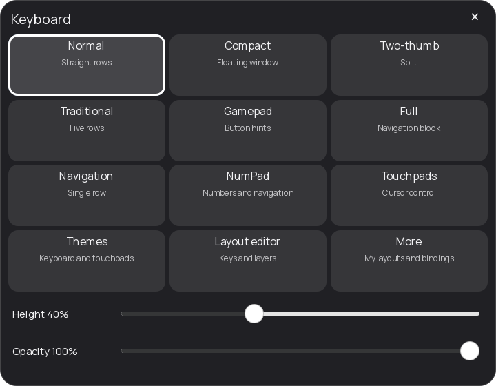

Use the **height** and **opacity** sliders to fit the keyboard to your display; each view remembers its settings. **Themes** provides Dark, Light, Black, High contrast, Blue, Lilac, Mint and Terracotta palettes. Keyboard and touchpad themes can be selected separately.

### More, custom layouts and macros

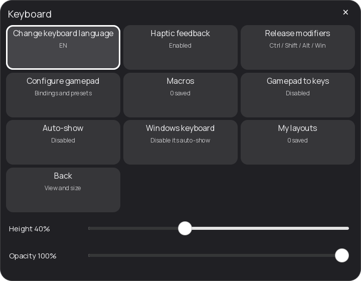

| Menu item | Purpose |
|---|---|
| **Change keyboard language** | Switch between Windows input layouts. The NGS interface language is configured separately in Settings. |
| **Haptic feedback** | Toggle keyboard vibration on supported hardware. |
| **Release modifiers** | Release held Ctrl, Shift, Alt and Win keys. |
| **Configure gamepad** | Open controller-to-key assignments and presets. |
| **Macros / Stop macro** | Run a saved sequence or stop the current one. |
| **Gamepad to keys** | Enable or disable sending configured keyboard keys from the controller. |
| **Auto-show** | Allow the keyboard to open after a short finger tap on an editable field. |
| **Windows keyboard** | Open Windows typing settings to manage the system keyboard's own behavior. |
| **My layouts** | Choose a saved custom keyboard layout. |
| **Back** | Return to the view menu. |

**Tap-to-show** responds to a completed finger tap on an editable field. Scrolling, holding, multiple fingers, mouse clicks and focus changes from a controller or software do not request automatic opening. Manual activation remains available when Auto-show is off. Switching off **NGS keyboard** disables both automatic and manual opening.

**Layout editor** starts from the current layout. Add or remove rows and keys, move keys, adjust their width and edit the base, Shift, AltGr and Shift+AltGr layers. Name and save the result, then select it in **My layouts**.

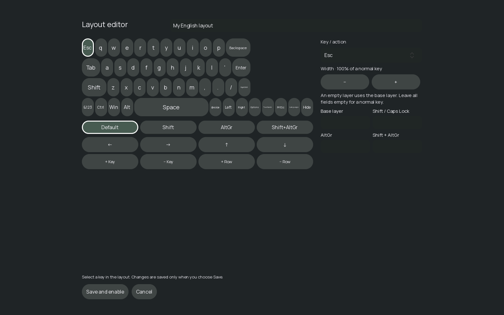

**Macros** combine keys, shortcuts and pauses, for example `Ctrl+C; wait:200; Ctrl+V`. You can save up to 20 macros, with up to 100 steps and 30 seconds per sequence. Use **Stop macro** to interrupt execution and **Release modifiers** when you need to clear held modifiers.

Create them in **Buttons and gamepad → Macros and gamepad**: enter a name and sequence, then **Save macro**. Saved entries have **Edit**, **Delete** and **Run** actions. This page also opens the keyboard and its controller editor.

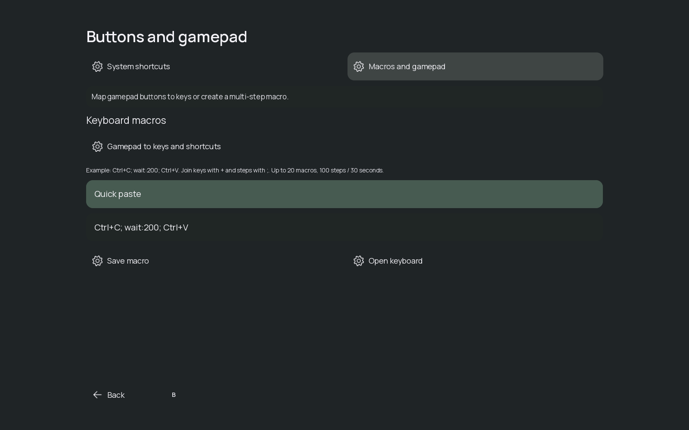

### Controller assignments

The **System shortcuts** tab assigns **Desktop / minimize NGS**, **Show NGS** and **Show / hide keyboard**. Choose **Assign**, then press the desired input; **Remove** clears it. Choose a short press or a **0.7-second long press**. The desktop/show actions also offer a toggle between hiding and restoring NGS.

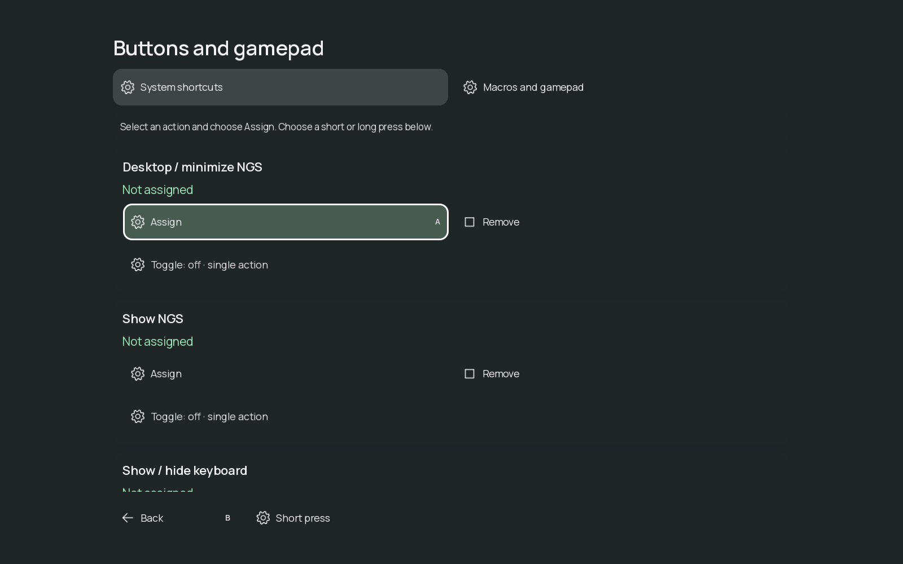

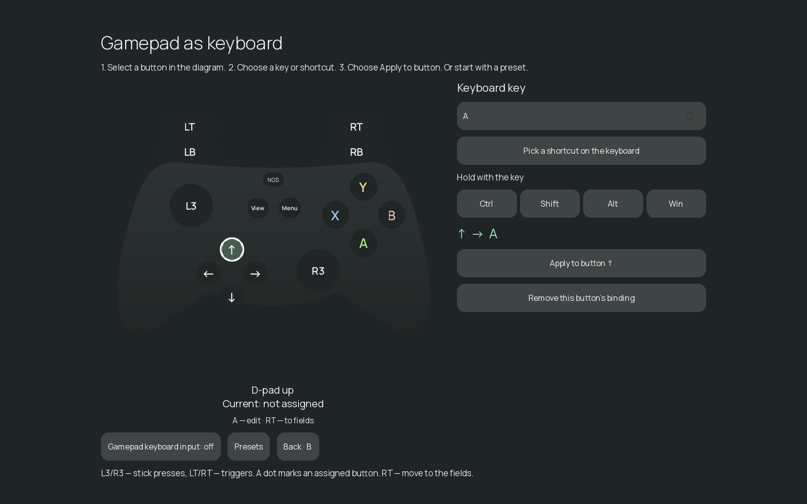

The keyboard's controller editor separately maps the D-pad, face buttons, shoulders, triggers and stick clicks to keyboard keys, optionally combined with Ctrl, Shift, Alt or Win.

Start with a **WASD**, **Arrow keys** or **Racing** preset, or edit individual assignments. Applying one assignment and replacing a preset are separate actions. The option to send keys while the keyboard is hidden is useful for games that expect a keyboard; enable it deliberately because those bindings also apply with the keyboard closed.

### Touchpads

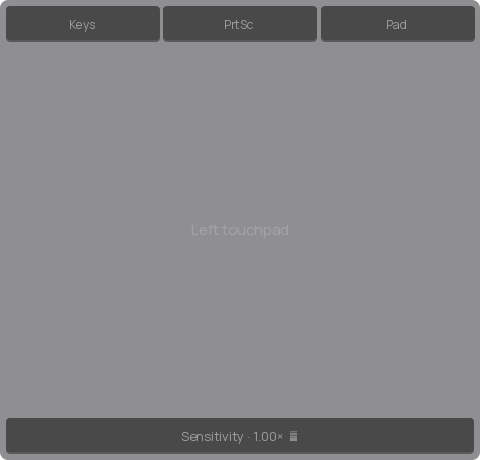

**Touchpads** opens left and right cursor-control surfaces. Move the pointer, click, right-click and scroll; return to the keyboard when typing is needed. Adjust sensitivity, size and opacity, select a separate theme and configure controller assignments. The screenshot action briefly hides the NGS controls before capturing; capture support depends on the game and display mode.

### What NGS Input adds

**NGS Input** is an optional Windows component that lets the keyboard and quick controls appear above Start and other supported system windows. Install it with the Windows installer or **Settings → Controllers and input → Install / update NGS Input**. This action asks for confirmation and Windows installation permission; it does not merely open the keyboard.

The keyboard itself is already built in. NGS Input does not guarantee overlays above every exclusive fullscreen game or anti-cheat system.

## Two NAS catalog managers

Both managers are under **Settings → Catalog and publishing**. They organize the server's library; adding or publishing NAS games requires the server owner's permissions. Players can browse and download published entries.

| Manager | Source on NAS | Result |
|---|---|---|
| **Ready-to-play game catalog manager** | A complete game folder with its working game executable. | A Catalog entry to download and launch locally. |
| **Installer package catalog manager** | A complete setup folder with its setup executable and companion data files. | An Installers entry to download and install normally on the device. |

### Publish a ready-to-play game

1. Open **Ready-to-play game catalog manager**.
2. **Folder:** choose the game's folder on the NAS.
3. **Launch:** choose the actual game executable, rather than an uninstaller or utility.
4. **Artwork:** match the title or use a supported game-page URL. Check the match and artwork; use the manual path if needed.
5. **Review:** inspect the title and game presentation.
6. **Publish:** confirm the entry. It becomes available in Catalog; download it on the device before playing.

### Publish an installation package

1. Open **Installer package catalog manager**.
2. Choose the complete setup folder, including the files required by its installer.
3. Select the setup executable and complete **Artwork → Review → Publish**.
4. On the device, open **Installers** and download the package.
5. Run its setup and finish the installation normally.
6. Add the installed game folder to **My games** using the local scanner.

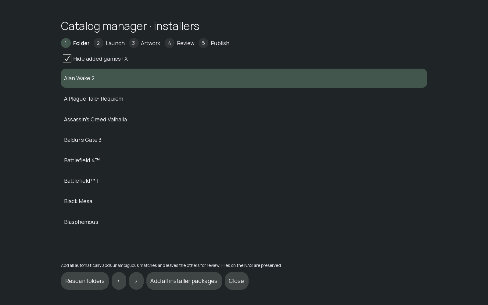

An installation package is not automatically a ready-to-play game. Keep setup companion files together; publishing a setup entry does not run installation on the handheld.

### Folder list and batch actions

- **Hide already added:** focus on folders that still need an entry.
- **Rescan folders:** refresh the NAS folder list.
- **Previous / next page:** navigate a larger collection.
- **Add all games / Add all packages:** process unambiguous matches; leave ambiguous or failed items for manual review.
- **Stop adding:** stop further processing while keeping completed entries.
- **Close:** leave the screen. An active server job may continue; closing the screen is not cancellation.

NAS game sources remain read-only. Publishing creates catalog metadata and download packages; it does not rename your source folders or download a game to the device by itself.

The **local scanner** in My games serves a different purpose: it adds existing local or supported store games to this device's library. It does not publish those games on the NAS.

## Quick settings and the top-edge handle

Open quick settings from the top-edge handle or a configured shortcut. The handle and the entire quick-settings menu have separate switches in **Controllers and input**. Auto-hide moves the handle away after **4 seconds**; start the swipe from the same top-edge area to reveal it.

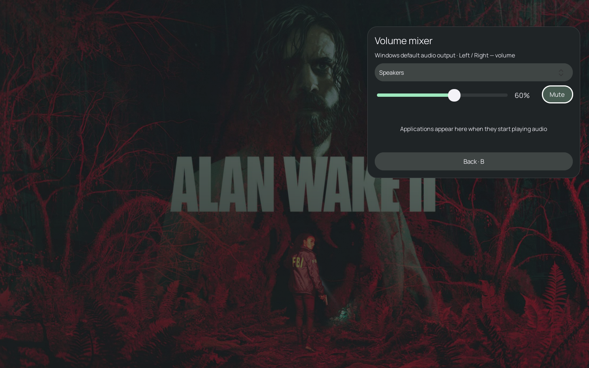

| Panel | Controls |
|---|---|
| **Volume mixer** | Master volume, mute, output device and active application audio sessions. |
| **Screen brightness** | Brightness of a supported built-in display. |
| **Wi-Fi** | Adapter state, scanning, connection and disconnection. |
| **Bluetooth** | Adapter state, discovery, pairing and unpairing. Windows may ask for confirmation. |
| **Battery and power** | Charge and power state; energy saver where supported. |
| **Date and time** | Current date and time. |

**Windows edge gestures:** while fullscreen NGS is active, enabling the handle disables Windows edge gestures, including the swipe that opens Start. Turn off **Quick settings edge handle** to restore them. The Windows Start button still works. Turning off **NGS quick settings** closes the panel and disables all its activation methods.

## Settings reference

The settings home contains six sections. All settings on this screen stay as a draft until you choose **Apply**, including language, appearance, keyboard/handle switches and startup. **B / Back** returns to the section list and keeps the draft. Leaving settings or opening a child page with unsaved edits asks you to **Apply**, **Discard changes** or **Keep editing**. A failed save keeps your edits and displays the error. Settings that require restarting NGS do so after Apply; an active game defers that restart until the game closes. Actions such as installing NGS Input or organizing the library have their own controls.

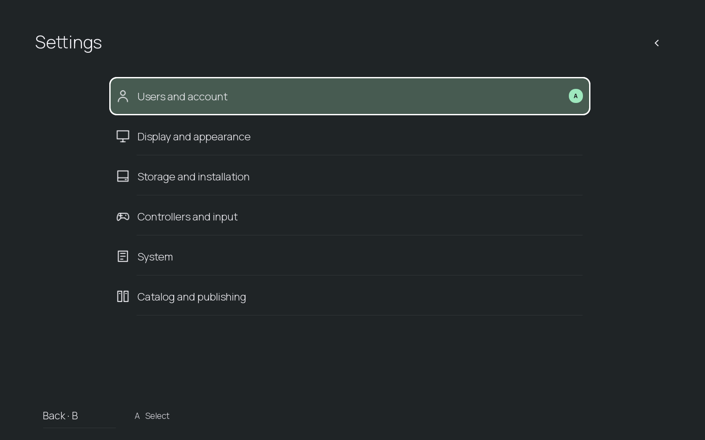

| Section | Available settings and pages |
|---|---|
| **Users and account** | Server address; sign in or register; profile and backups; automatic library/settings backup. The account page also handles local pairing, device backups, saved revisions and restoration. |
| **Display and appearance** | English/Russian language; dark/light theme; Green, Blue, Violet, Amber or Rose accent; graphics API (Direct3D 11 by default, Direct3D 12, Vulkan, OpenGL or Software); hide third-party overlays/FPS counters in NGS; interface scale; Normal/Fast/Off animations; background blur; startup section; fullscreen/windowed mode; display refresh-rate readout. |
| **Storage and installation** | Game installation folders; Add folder; automatically resume downloads at startup; free-space reserve (512 MiB, 2 GiB, 5 GiB or 10 GiB); Organize library. The first destination is the default; changing it does not move installed games. |
| **Controllers and input** | Buttons and gamepad; NGS keyboard; NGS quick settings; edge handle; four-second handle auto-hide; Install / update NGS Input; gamepad vibration; stick deadzone (15%, 25% or 35%); navigation repeat speed (Normal/Fast/Slow). |
| **System** | Start with Windows; NGS updates; automatically check for updates; minimize to the system tray; freeze the running game before sleep; trim game memory when freezing; Production mode. |
| **Catalog and publishing** | Find artwork for local games; ready-to-play game catalog manager; installer package catalog manager; game-matching database update URL (JSON). |

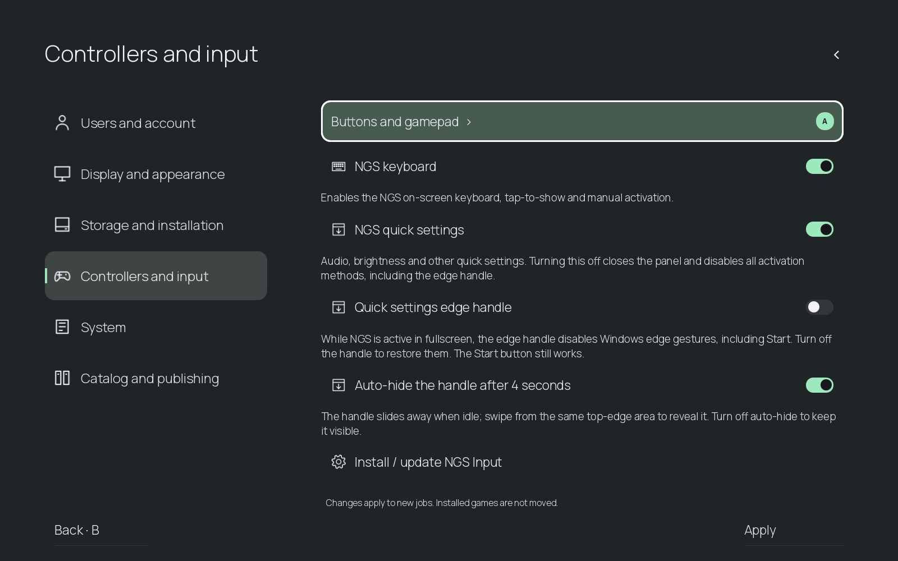

**Organize library** gives NGS-managed downloads readable folder and library names. It leaves independently installed games and NAS source files unchanged.

**Hide third-party overlays and FPS counters** applies to hooks in the NGS window, including RTSS/Afterburner and supported graphics layers. It preserves game overlays; it is not a global switch for every game's overlay.

**Production mode** disables diagnostic logs, tracing and diagnostic uploads. NGS restarts to apply it, or waits until the current game closes.

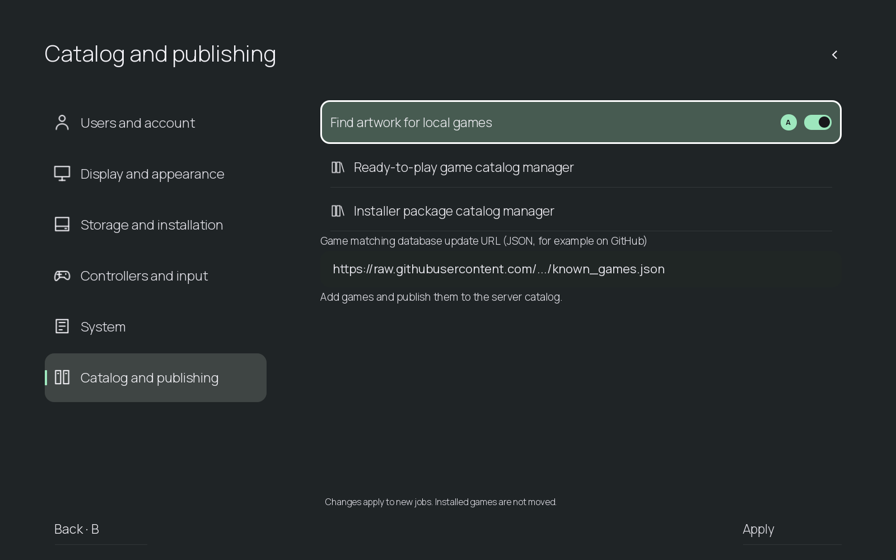

## Installation and screenshot notes

For the Windows installer, Docker kit, Synology SPK, server accounts and optional public HTTPS, follow the [quick start](../README.md#get-started) and [server instructions](../server/README.md).

These screenshots show the actual NGS interface in English, using cached artwork from real games. Catalog-manager folder rows and system-control values illustrate the interface. No NAS entries were published, games launched or Windows settings changed to create them. Screenshots are not a compatibility test for the pictured games. Games and artwork belong to their respective owners and are not included with NGS.
