[English](guide.md) · **Русский** · [О проекте](../README.ru.md) · [Установка сервера](../server/README.ru.md)

# Как пользоваться NAS Game Switcher

Игры, загрузки и управление приставкой в одном месте. В этом руководстве описаны встроенная клавиатура, оба каталогизатора NAS, основные меню и все разделы настроек текущей предварительной версии.

NGS находится в разработке. Доступность аппаратных настроек и поведение оверлеев зависят от Windows, устройства и запущенной игры.

## Библиотека и главное меню

### Локальная библиотека без сервера

Чистая установка сразу открывает **Мои игры**. Для добавления и запуска существующих локальных игр не нужны NAS, Docker, аккаунт или подключение к интернету. Через **Добавить игру с этого устройства** можно выбрать папку или найти поддерживаемые установки Steam, GOG, Epic Games Store и Battle.net.

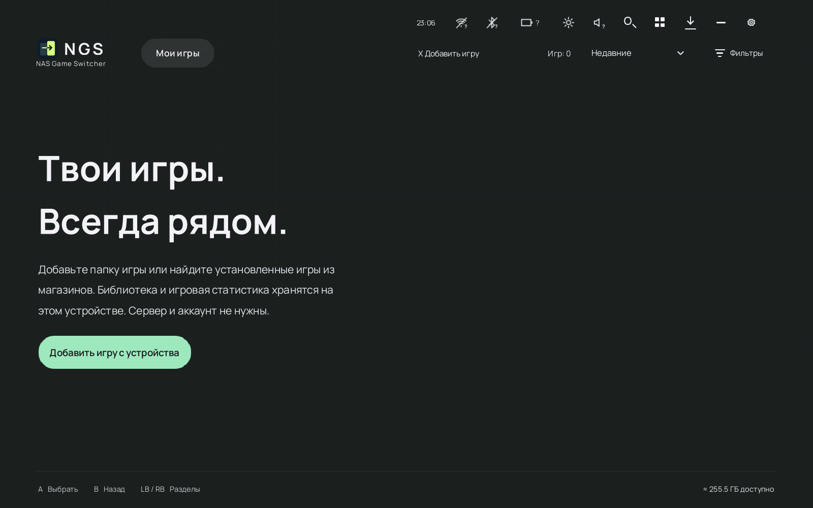

Библиотека, параметры запуска и игровая история хранятся в **`data/state/library.sqlite`** на устройстве. Для сохранения настроек, кешированного оформления и остальных файлов профиля сохраняйте папку **data** целиком. Игры остаются в своих установочных папках. В локальном режиме не запускаются скачивание с NAS, синхронизация профиля и серверные резервные копии.

Обложки, фоны и описания поступают напрямую из публичных игровых источников: Steam, GOG, Epic Games Store и баз сообщества. NAS, аккаунт и личный API-ключ не требуются. Для первой загрузки нужен интернет; сохранённые описания и изображения остаются доступны без сети. При импорте из магазинов и сканировании папок однозначные совпадения оформляются автоматически. NGS также заполняет недостающее оформление уже добавленных локальных игр во время простоя; автоматический поиск можно выключить в **Настройки → Каталог и публикация → Искать оформление локальных игр**. Спорные совпадения выбираются вручную через действие оформления в карточке игры. Изменение оформления сохраняет файлы игры, параметры запуска и статистику. Описания из Steam учитывают английский/русский язык интерфейса.

Если оформление не найдено или игра определилась неправильно, откройте её карточку в **Мои игры → Изменить игру / оформление**. Введите правильное название или поддерживаемую ссылку на магазин, выберите результат и проверьте обложку и описание. **Выбрать эту игру** сохраняет выбор; **К результатам / B** возвращает к поиску без изменения библиотеки. Это доступно и при добавлении локальной игры. Подтверждённый ручной выбор сохраняется после перезапуска и защищён от автоматического сопоставления.

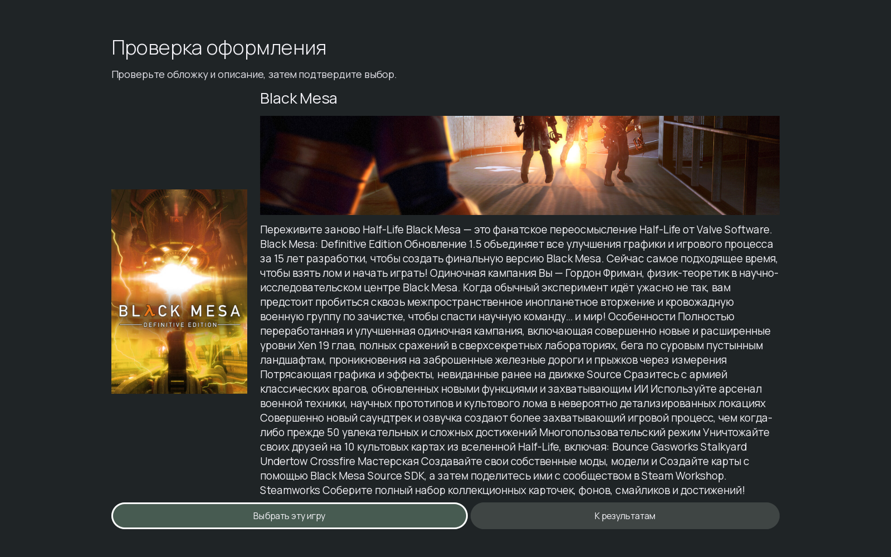

Если игры нет ни в одной базе, на этом экране выберите **Оформить вручную**. Введите название и описание, перейдите к **Изображениям**, выберите обложку PNG, JPEG или WebP с диска и сохраните. Отдельный фон необязателен: для новой карточки без выбранного фона используется обложка. Изображения уменьшаются и копируются в локальный кеш, поэтому перемещение или удаление оригиналов не убирает их из библиотеки. Интернет не нужен; редактор доступен и при добавлении локальной игры. Его можно открыть повторно для изменения названия, описания и картинок; автопоиск не трогает такие карточки.

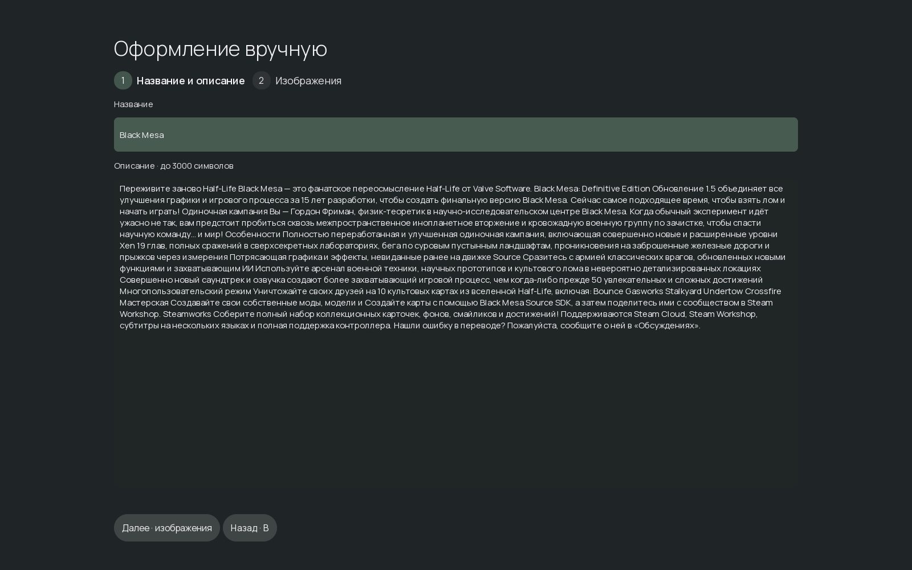

Чтобы подключиться позднее, получите ссылку из **Админка NAS → Подключение NGS → Скопировать ссылку**. Это обычный адрес NAS, например `https://nas.example/tactic/ngs_launcher/#ngs-key=…`: в браузере он открывает сервер, а в NGS заполняет и адрес, и публичный отпечаток ключа. Вставьте ссылку в **Настройки → Пользователи и аккаунт → Подключить NAS**, проверьте адрес и нажмите **Использовать этот сервер**. Это только заполняет форму; подпись сервера проверяется при подключении. Получайте ссылку по доверенному каналу. В ней нет пароля, токена входа или закрытого ключа; часть после `#` не отправляется в HTTP-запросах.

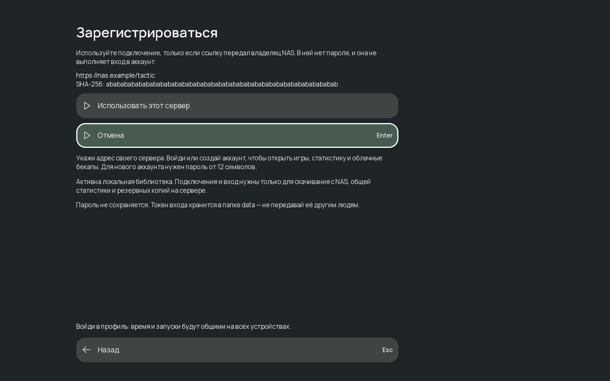

Выберите **Создать аккаунт** либо **Войти**. Логин — 3–32 латинские буквы, цифры, точки, дефисы или подчёркивания. Новый пароль — 12–128 символов, вводится дважды. Ошибки и результат сервера постоянно видны под формой. Можно указать и обычный адрес: доверенный HTTPS проверяется автоматически, для первого локального HTTP-подключения может понадобиться код из журнала NAS. Доступ через интернет требует доверенного HTTPS.

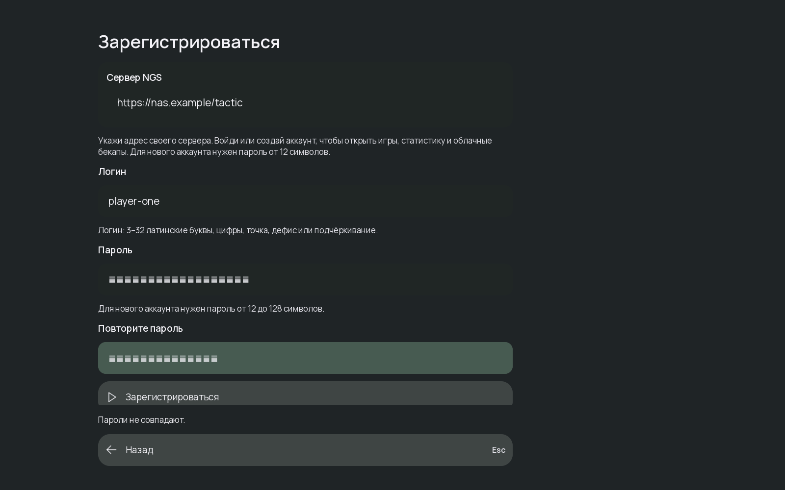

После успешного входа появятся «Каталог» и «Установщики», локальные игры и статистика сохранятся. Прежняя история отправляется только кнопкой **Загрузить предыдущую историю**. Чтобы вернуться в локальный режим, завершите активные игры и серверные операции и выберите **Использовать без сервера**.

| Раздел | Для чего нужен |
|---|---|
| **Мои игры** | Игры, доступные на этом устройстве, включая поддерживаемые записи магазинов и самостоятельно добавленные папки. Действие добавления/сканирования находит локальные игры. |
| **Каталог** | Готовые к запуску игры, опубликованные на вашем NAS. Перед игрой скачайте выбранную игру в локальную папку. |
| **Установщики** | Установочные комплекты с NAS. Скачайте полный комплект, запустите установку и добавьте установленную игру в «Мои игры». |
| **Поиск** | Поиск игр в текущей библиотеке. |
| **Фильтры** | Отбор по жанру и доступности. В локальной библиотеке можно также найти ещё не запускавшиеся или недоступные игры. Набор фильтров зависит от раздела. |
| **Сортировка** | По последнему запуску, дате добавления, названию или жанру; порядок можно менять. |
| **Вид** | Переключение между лентой и плитками. |
| **Загрузки** | Очередь и ход передачи; пауза, продолжение или отмена. Игры в очереди резервируют локальное место. |
| **Меню программы** | Настройки, сворачивание и выход из NGS. |

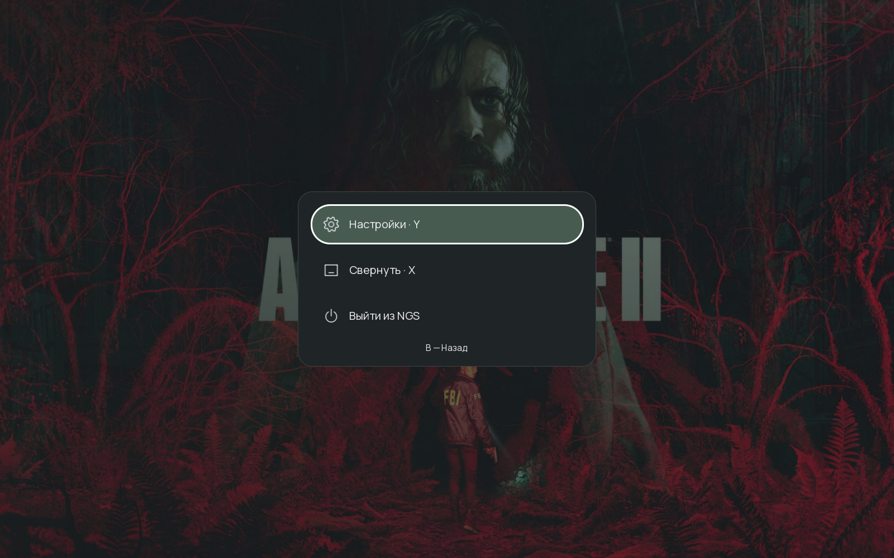

Ориентируйтесь на выделенный пункт и подсказки экрана: **A / Enter** выбирает, **B / Назад** возвращает. Подсказки учитывают активное устройство ввода и назначения кнопок. Также доступны тач и мышь.

С клавиатуры: **стрелки** — навигация, **Enter** — выбрать, **F10** — информация об игре, **Esc** — назад, **Q / E** — разделы, **F2** — настройки, **Ctrl+F** — поиск. Клавиатурные подсказки видны со старта и возвращаются при использовании клавиатуры или мыши после геймпада.

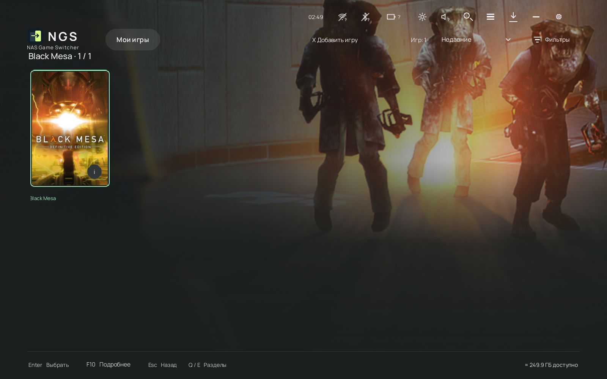

Чтобы посмотреть игру без запуска, нажмите **i** на плитке, **Подробнее** в ленте, **F10 · Подробнее** в нижней строке или клавишу **F10**. В карточке есть **Статистика на этом устройстве**: общее время, число запусков и самая длинная сессия, включая уже завершённые игры. Просмотр карточки не запускает игру. Если записанных сессий ещё нет, показываются нули. Экран запущенной игры также сохраняет текущую сессию и общую статистику профиля.

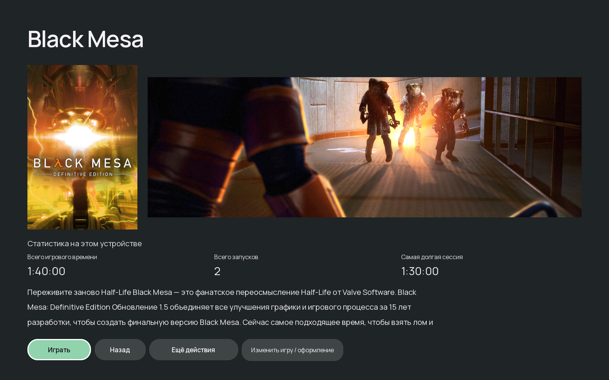

Кнопка **Сбросить статистику** доступна прямо в карточке. Подтвердите **Сбросить на этом устройстве?**, чтобы обнулить показатели этой игры на приставке без её запуска. Общая статистика профиля и другие устройства сохраняются; отмена ничего не меняет.

Выберите **Настройки → Экран и оформление → Язык** и нажмите **Применить**. Интерфейс NGS и подключённого NGS Input сразу сменит язык; окно NGS и запущенная игра останутся открытыми. Другие параметры, например графический API, по-прежнему могут требовать перезапуска NGS.

В карточке игры находятся описание, оформление и доступные действия: скачивание или запуск, избранное, параметры запуска, выбор папки/исполняемого файла и управление записью библиотеки. Экран сессии показывает игровую статистику, позволяет вернуться в игру, свернуть NGS и завершить запущенную игру. **Сброс статистики** обнуляет показатели этой игры на текущем устройстве.

Удаление внешней записи из библиотеки сохраняет её файлы. Удаление скачанной через NGS игры с диска — отдельное действие с подтверждением.

## Встроенная клавиатура

Клавиатура NGS уже входит в клиент. Открыть её можно через **Настройки → Контроллеры и ввод → Кнопки и геймпад → Макросы и геймпад → Открыть клавиатуру** либо назначенной служебной комбинацией. Отдельный переключатель **Клавиатура NGS** разрешает ручной вызов и автоматическое появление по тапу.

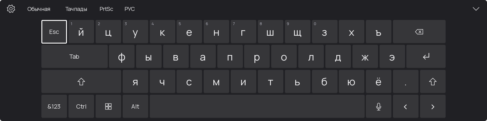

На панели клавиатуры находятся настройки, смена вида, переход к тачпадам, снимок экрана, смена языка ввода Windows и скрытие клавиатуры. Клавиша микрофона вызывает голосовой ввод Windows, если он доступен.

### Восемь видов клавиатуры

| Вид | Для чего подходит |
|---|---|
| **Обычная** | Повседневный ввод с ровными рядами клавиш. |
| **Компактная** | Небольшое плавающее окно, которое можно перемещать. |
| **Для двух пальцев** | Две половины для ввода большими пальцами, когда приставка в руках. |
| **Традиционная** | Привычное расположение в пять рядов. |
| **Геймпад** | Ввод с подсказками кнопок контроллера. |
| **Полная** | Расширенная клавиатура с функциональными и навигационными клавишами. |
| **Навигация** | Один ряд навигационных клавиш и частых команд. |
| **NumPad** | Цифры и навигация без полной буквенной клавиатуры. |

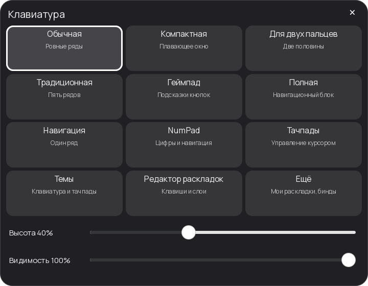

Ползунки **высоты** и **видимости** позволяют настроить размер и прозрачность; каждый вид запоминает свои параметры. В **Темах** доступны тёмная, светлая, чёрная, контрастная, синяя, сиреневая, мятная и терракотовая палитры. Оформление клавиатуры и тачпадов выбирается отдельно.

### «Ещё», свои раскладки и макросы

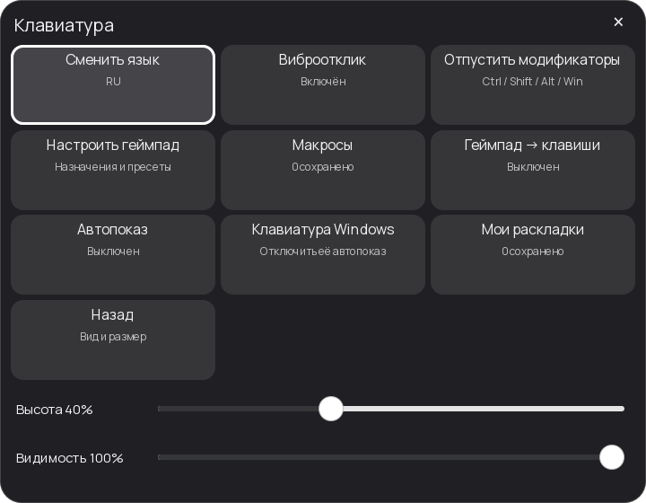

| Пункт меню | Назначение |
|---|---|
| **Сменить язык клавиатуры** | Переключить раскладку ввода Windows. Язык интерфейса NGS выбирается отдельно в настройках. |
| **Виброотклик** | Включить или выключить вибрацию клавиатуры на поддерживаемом оборудовании. |
| **Отпустить модификаторы** | Отпустить удерживаемые Ctrl, Shift, Alt и Win. |
| **Настроить геймпад** | Открыть назначения клавиш на кнопки и готовые схемы. |
| **Макросы / Остановить макрос** | Выполнить сохранённую последовательность или прервать текущую. |
| **Геймпад в клавиши** | Включить или выключить отправку назначенных клавиш с контроллера. |
| **Автопоказ** | Разрешить открытие после короткого тапа пальцем по редактируемому полю. |
| **Клавиатура Windows** | Открыть настройки ввода Windows для управления поведением системной клавиатуры. |
| **Мои раскладки** | Выбрать сохранённую собственную раскладку. |
| **Назад** | Вернуться к меню видов. |

**Автопоказ по тапу** реагирует на завершённое короткое касание редактируемого поля. Прокрутка, удержание, несколько пальцев, клики мышью и смена фокуса геймпадом или программой не вызывают автоматическое открытие. При выключенном автопоказе остаётся ручной вызов. Выключение **Клавиатуры NGS** запрещает и автоматическое, и ручное открытие.

**Редактор раскладок** берёт за основу текущую раскладку. Добавляйте и удаляйте ряды и клавиши, перемещайте клавиши, меняйте их ширину и содержимое слоёв: основной, Shift, AltGr и Shift+AltGr. Задайте имя, сохраните результат и выбирайте его через **Мои раскладки**.

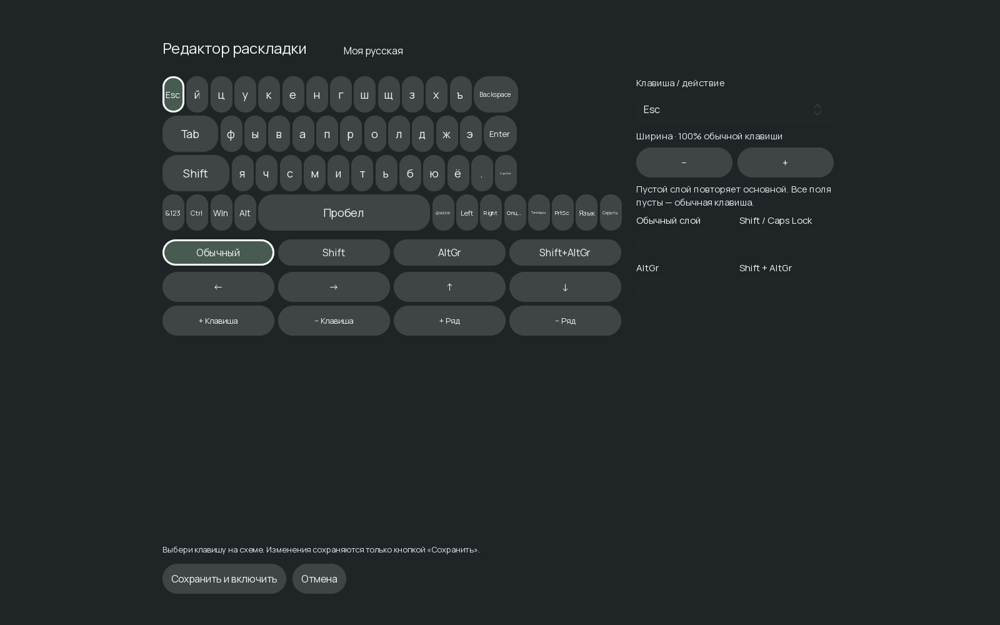

**Макросы** объединяют клавиши, сочетания и паузы, например `Ctrl+C; wait:200; Ctrl+V`. Можно сохранить до 20 макросов, до 100 шагов и 30 секунд на последовательность. **Остановить макрос** прерывает выполнение; **Отпустить модификаторы** снимает удерживаемые служебные клавиши.

Создавайте их в **Кнопки и геймпад → Макросы и геймпад**: введите имя и последовательность, затем нажмите **Сохранить макрос**. У сохранённых записей есть действия **Изменить**, **Удалить** и **Запустить**. Здесь же открываются клавиатура и её редактор управления геймпадом.

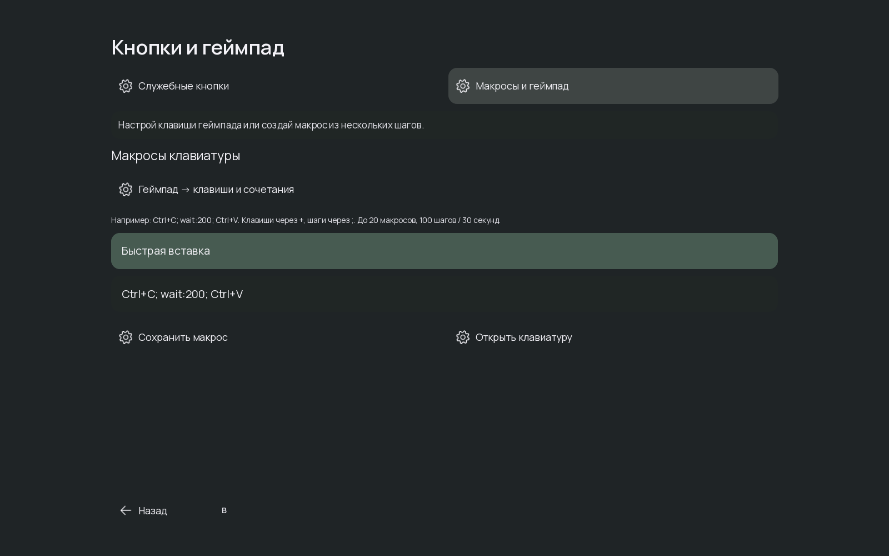

### Назначения геймпада

На вкладке **Служебные кнопки** назначаются **Рабочий стол / свернуть NGS**, **Показать NGS** и **Показать / скрыть клавиатуру**. Выберите **Назначить**, затем нажмите нужную кнопку; **Удалить** очищает привязку. Доступны короткое нажатие и **удержание 0,7 секунды**. Для действий сворачивания/показа также есть режим переключения между скрытием и восстановлением NGS.

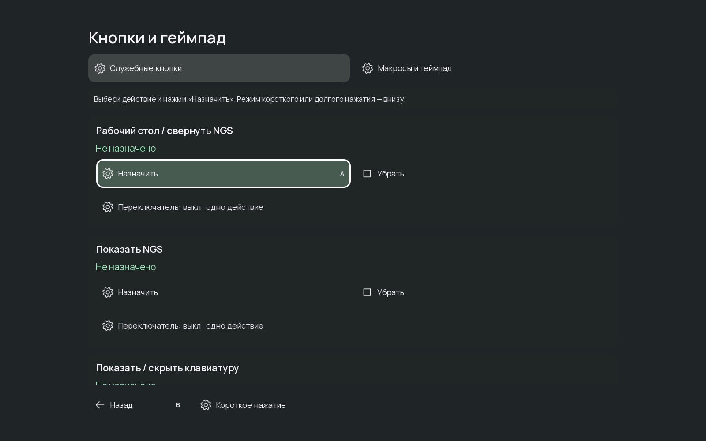

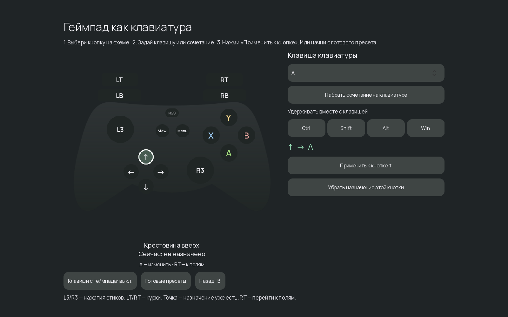

Отдельный редактор клавиатуры назначает на крестовину, основные кнопки, бамперы, триггеры и нажатия стиков клавиши, в том числе с Ctrl, Shift, Alt или Win.

Можно начать со схемы **WASD**, **Стрелки** или **Гонки**, затем изменить отдельные назначения. Применение одной привязки и замена готовой схемой — разные действия. Возможность отправлять клавиши при скрытой клавиатуре полезна для игр с клавиатурным управлением; включайте её осознанно, поскольку назначения действуют и после закрытия клавиатуры.

### Тачпады

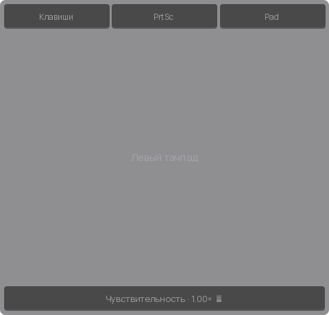

**Тачпады** открывают левую и правую поверхности управления курсором. Доступны движение указателя, обычный и правый клик, прокрутка и возврат к клавиатуре. Настраиваются чувствительность, размер, прозрачность, отдельная тема и назначения контроллера. Перед снимком экрана элементы NGS кратковременно скрываются; доступность захвата зависит от игры и режима вывода.

### Что добавляет NGS Input

**NGS Input** — дополнительный компонент Windows для показа клавиатуры и быстрых настроек поверх «Пуска» и других поддерживаемых системных окон. Он устанавливается вместе с клиентом либо через **Настройки → Контроллеры и ввод → Установить / обновить NGS Input**. Действие требует подтверждения и разрешения Windows на установку; это не обычная кнопка открытия клавиатуры.

Сама клавиатура уже встроена. NGS Input не гарантирует показ поверх каждой игры в эксклюзивном полноэкранном режиме или с античитом.

## Два каталогизатора NAS

Оба находятся в **Настройки → Каталог и публикация**. Они оформляют серверную библиотеку; для добавления и публикации игр нужны права владельца сервера. Игроки могут просматривать и скачивать опубликованные записи.

| Каталогизатор | Исходная папка на NAS | Результат |
|---|---|---|
| **Каталогизатор готовых игр** | Полная папка игры с рабочим исполняемым файлом. | Запись в «Каталоге» для скачивания и локального запуска. |
| **Каталогизатор установщиков** | Полный установочный комплект с setup-файлом и необходимыми файлами данных. | Запись в «Установщиках» для скачивания и обычной установки на устройство. |

### Публикация готовой игры

1. Откройте **Каталогизатор готовых игр**.
2. **Папка:** выберите папку игры на NAS.
3. **Запуск:** укажите исполняемый файл самой игры, а не деинсталлятор или утилиту.
4. **Оформление:** найдите игру по названию или поддерживаемой ссылке на её страницу. Проверьте совпадение и изображения; при необходимости используйте ручное оформление.
5. **Проверка:** просмотрите название и представление игры.
6. **Публикация:** подтвердите запись. Она появится в «Каталоге»; перед запуском скачайте игру на устройство.

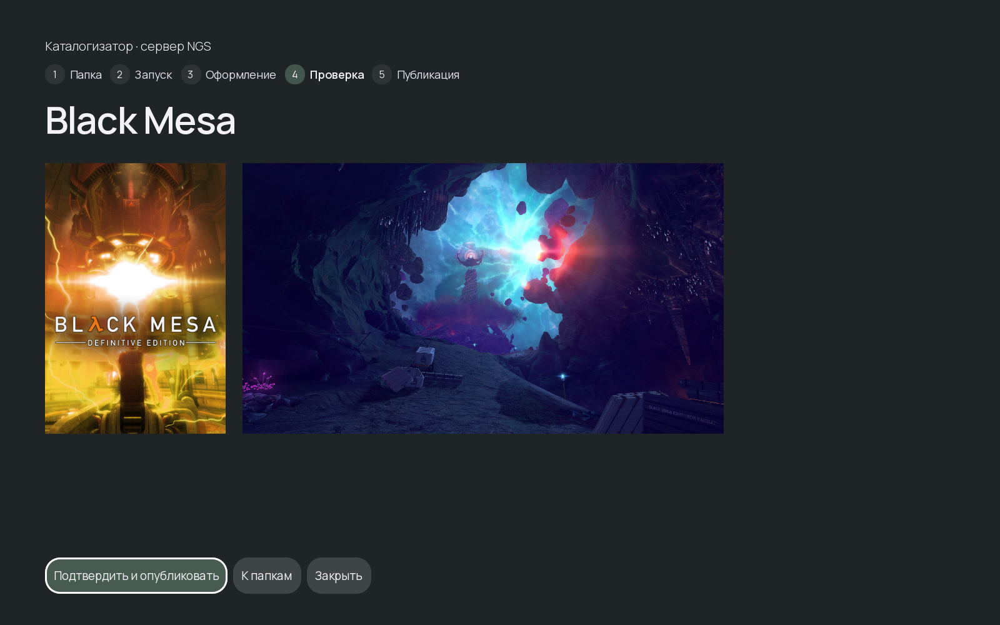

### Публикация установочного комплекта

1. Откройте **Каталогизатор установщиков**.
2. Выберите папку полного комплекта, включая файлы, необходимые установщику.
3. Укажите исполняемый файл установки и пройдите **Оформление → Проверка → Публикация**.
4. На устройстве откройте **Установщики** и скачайте комплект.
5. Запустите setup и выполните обычную установку.
6. Добавьте установленную папку игры в **Мои игры** локальным сканером.

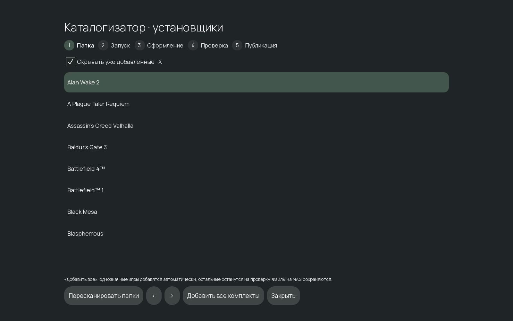

Установочный комплект не становится готовой к запуску игрой автоматически. Сохраняйте сопутствующие файлы рядом с setup: публикация записи не запускает установку на приставке.

### Список папок и массовые действия

- **Скрывать уже добавленные:** оставить в списке папки, которым ещё нужна запись.
- **Пересканировать папки:** обновить список на NAS.
- **Предыдущая / следующая страница:** перемещаться по большой коллекции.
- **Добавить все игры / Добавить все комплекты:** обработать однозначные совпадения; спорные и ошибочные оставить для ручной проверки.
- **Остановить добавление:** прекратить дальнейшую обработку с сохранением завершённых записей.
- **Закрыть:** уйти с экрана. Активная серверная задача может продолжаться; закрытие экрана не означает отмену.

Исходные игровые папки NAS остаются доступны только для чтения. Публикация создаёт оформление каталога и пакеты для скачивания; она не переименовывает исходные папки и сама по себе не скачивает игру на приставку.

**Локальный сканер** в «Моих играх» решает другую задачу: добавляет в библиотеку этого устройства уже существующие локальные игры и поддерживаемые записи магазинов. Он не публикует их на NAS.

## Быстрые настройки и верхний язычок

Открывайте быстрые настройки язычком сверху или назначенной комбинацией. В **Контроллерах и вводе** есть независимые переключатели язычка и всего верхнего меню. Автоскрытие убирает язычок через **4 секунды**; чтобы вернуть его, начните свайп в той же верхней области экрана.

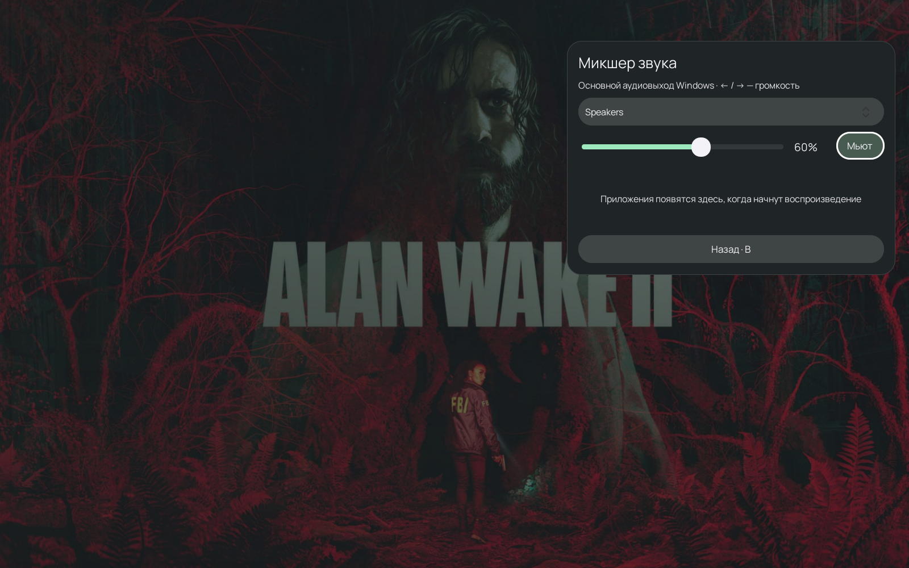

| Панель | Возможности |
|---|---|
| **Микшер громкости** | Общая громкость, отключение звука, устройство вывода и активные звуковые сеансы приложений. |
| **Яркость экрана** | Яркость поддерживаемого встроенного дисплея. |
| **Wi-Fi** | Состояние адаптера, поиск сетей, подключение и отключение. |
| **Bluetooth** | Состояние адаптера, поиск, сопряжение и удаление сопряжения. Windows может запросить подтверждение. |
| **Батарея и питание** | Заряд, состояние питания и энергосбережение, если оно поддерживается. |
| **Дата и время** | Текущие дата и время. |

**Системные свайпы Windows:** пока полноэкранный NGS активен, включённый язычок отключает жесты Windows от края, включая свайп вызова «Пуска». Чтобы вернуть их, выключите **Язычок вызова верхнего меню**. Сама кнопка «Пуск» продолжает работать. Выключение **Верхнего меню NGS** закрывает панель и отключает все способы её вызова.

## Справочник настроек

На главной странице настроек шесть разделов. Все параметры этого экрана остаются черновиком до нажатия **Применить**, включая язык, оформление, переключатели клавиатуры/язычка и автозапуск. **B / Назад** возвращает к списку разделов, сохраняя черновик. При выходе из настроек или открытии вложенной страницы с несохранёнными правками появится выбор: **Применить**, **Отбросить изменения** или **Продолжить редактирование**. Ошибка сохранения оставляет правки и показывает причину. Настройки, которым нужен перезапуск NGS, перезапускают программу после применения; при активной игре перезапуск откладывается до её завершения. Действия вроде установки NGS Input и приведения библиотеки в порядок запускаются своими кнопками.

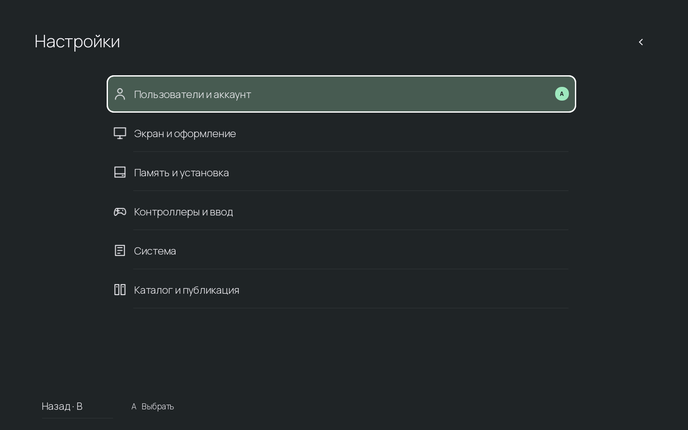

| Раздел | Настройки и страницы |
|---|---|
| **Пользователи и аккаунт** | Адрес сервера; вход или регистрация; профиль и резервные копии; автоматическое резервирование библиотеки/настроек. Страница аккаунта также содержит локальное сопряжение, копии устройств, сохранённые версии и восстановление. |
| **Экран и оформление** | Английский/русский язык; тёмная/светлая тема; зелёный, синий, фиолетовый, янтарный или розовый акцент; графический API (Direct3D 11 по умолчанию, Direct3D 12, Vulkan, OpenGL или Software); скрытие сторонних оверлеев/счётчиков FPS в NGS; масштаб интерфейса; обычные/быстрые/выключенные анимации; размытие фона; стартовый раздел; полноэкранный/оконный режим; отображение частоты обновления дисплея. |
| **Память и установка** | Папки установки игр; добавление папки; автоматическое продолжение загрузок при старте; резерв свободного места (512 МиБ, 2 ГиБ, 5 ГиБ или 10 ГиБ); «Привести в порядок». Первая папка используется по умолчанию; смена пути не переносит установленные игры. |
| **Контроллеры и ввод** | Кнопки и геймпад; клавиатура NGS; верхнее меню NGS; язычок; его автоскрытие через четыре секунды; установка/обновление NGS Input; вибрация геймпада; мёртвая зона стика (15%, 25% или 35%); скорость повтора навигации (обычная/быстрая/медленная). |
| **Система** | Запуск вместе с Windows; обновления NGS; автоматическая проверка обновлений; сворачивание в системный трей; заморозка запущенной игры перед сном; очистка памяти игры при заморозке; продакшен-режим. |
| **Каталог и публикация** | Поиск оформления для локальных игр; каталогизатор готовых игр; каталогизатор установщиков; адрес обновления базы сопоставления игр (JSON). |

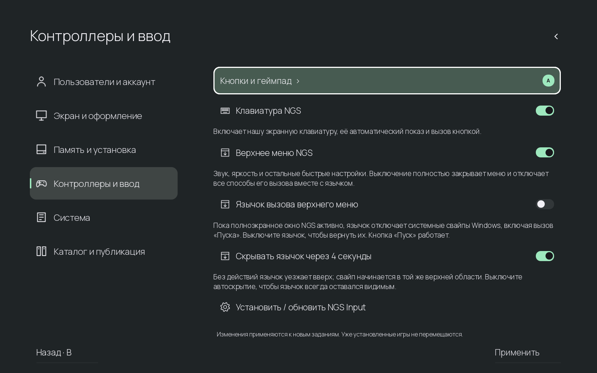

**Привести в порядок** задаёт читаемые имена папкам и записям скачанных через NGS игр. Самостоятельно установленные игры и исходные файлы на NAS не меняются.

**Скрытие сторонних оверлеев и счётчиков FPS** относится к внедрению в окно NGS, включая RTSS/Afterburner и поддерживаемые графические слои. Игровые оверлеи сохраняются; это не глобальное отключение оверлеев всех игр.

**Продакшен-режим** отключает диагностические журналы, трассировку и отправку диагностики. Для применения NGS перезапускается либо ждёт завершения текущей игры.

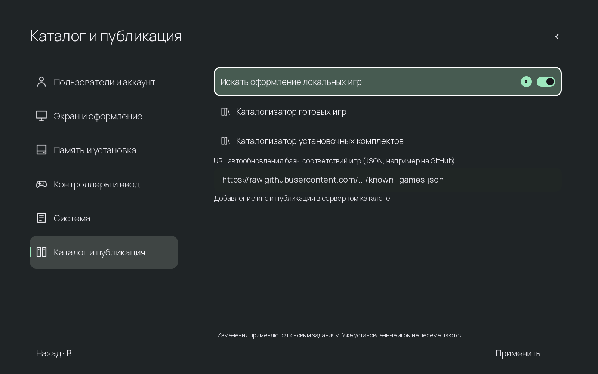

## Установка и примечания к скриншотам

Установщик Windows, Docker, пакет Synology SPK, аккаунты сервера и внешний HTTPS описаны в [краткой инструкции](../README.ru.md#начало-работы) и [руководстве сервера](../server/README.ru.md).

На скриншотах показан настоящий интерфейс NGS на русском языке с кешированным оформлением реальных игр. Строки папок каталогизатора и значения системных настроек приведены для демонстрации интерфейса. При съёмке записи на NAS не публиковались, игры не запускались, настройки Windows не менялись. Скриншоты не являются проверкой совместимости показанных игр. Игры и изображения принадлежат правообладателям и не входят в комплект NGS.
